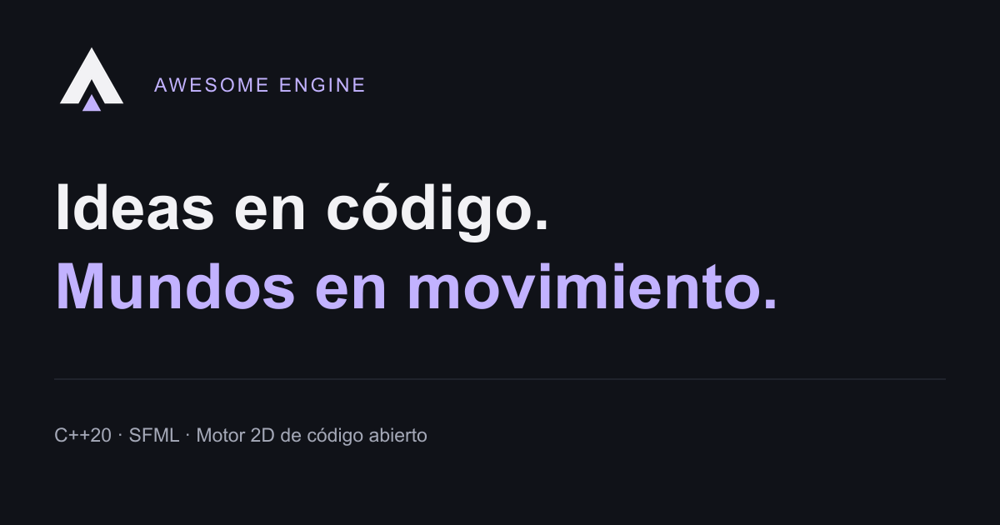
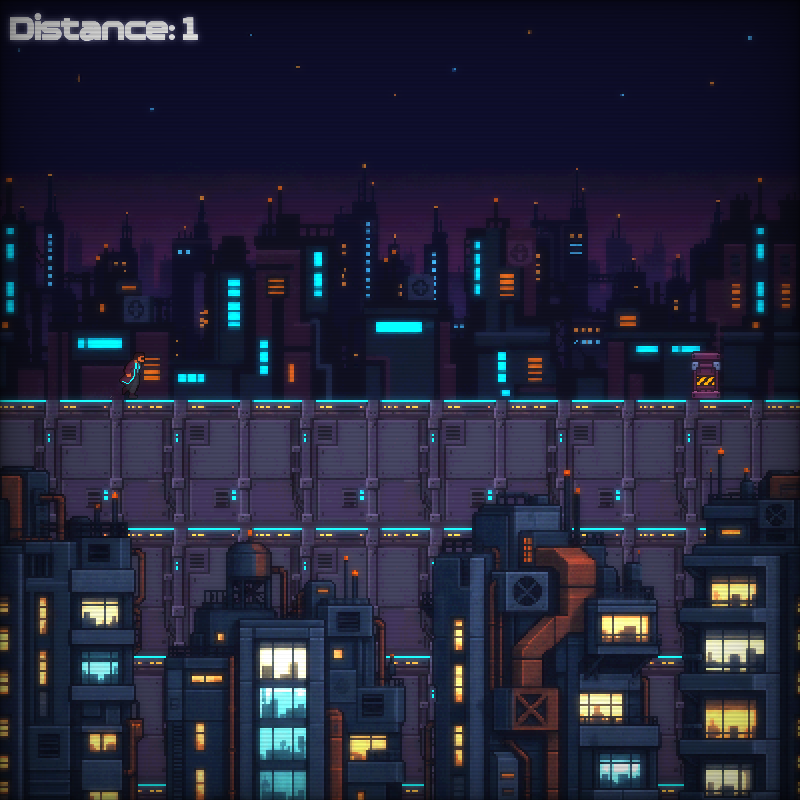
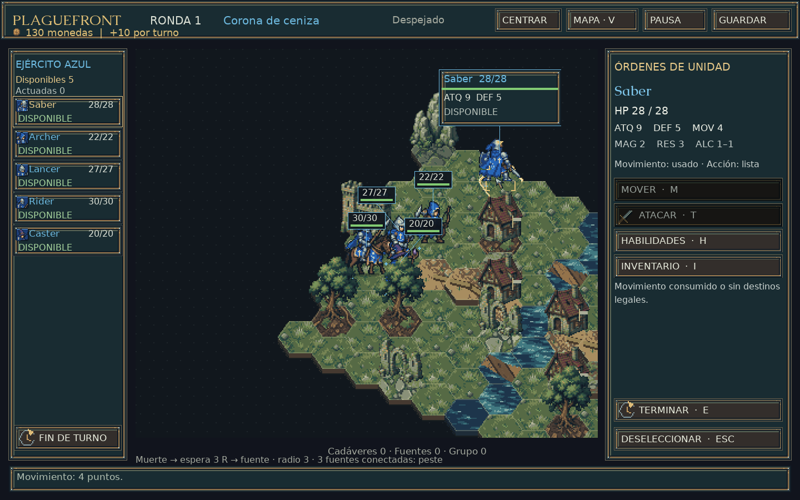
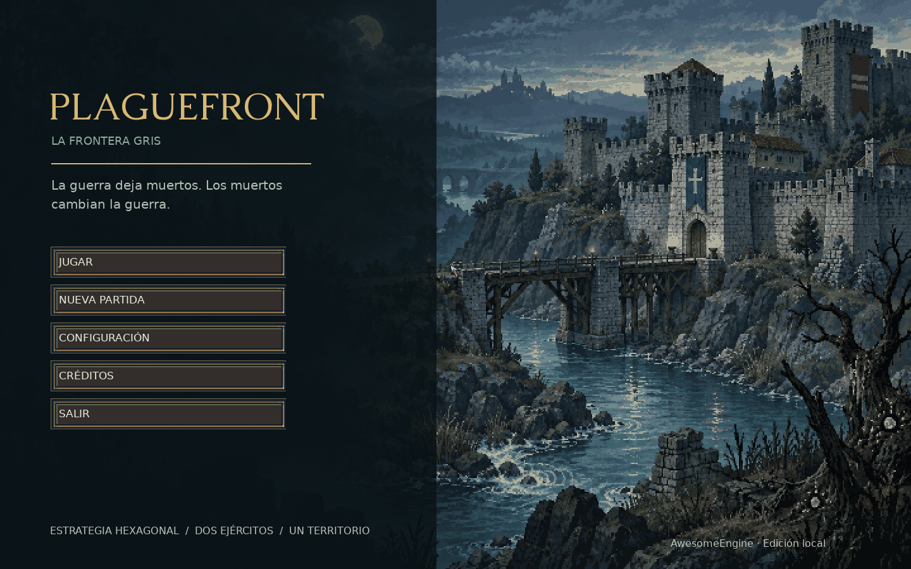
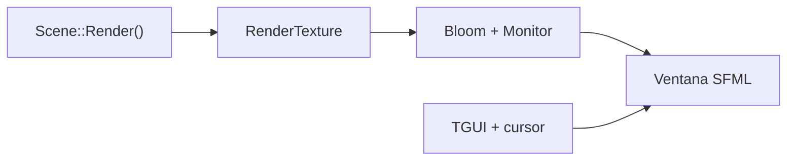

# Awesome Engine

<p align="center">
  <a href="https://awesomeengine.tech/">
    
  </a>
</p>

[](CMakeLists.txt)
[](https://github.com/SFML/SFML/tree/3.1.0)
[](CMakeLists.txt)
[](#plataformas)
[](LICENSE.md)
[](https://awesomeengine.tech/)

**Un motor de videojuegos 2D en C++20, construido sobre SFML, con escenas, renderizado, audio y servicios compartidos que puedes estudiar desde el código.**

Desarrollado por **Carlos Cortina**. Este repositorio reúne el núcleo y siete juegos de ejemplo en un ejecutable. La [web oficial](https://awesomeengine.tech/) conecta la documentación con las fuentes, muestra la evolución del proyecto y presenta capturas y videos de juegos ejecutándose realmente.

**[Empezar](#compilar-y-ejecutar)** · **[Documentación](https://awesomeengine.tech/docs/)** · **[Capturas](#capturas-de-pantalla)** · **[Showcase y videos](https://awesomeengine.tech/showcase/)** · **[Evolución](https://awesomeengine.tech/evolucion/)**

## ✨ Qué puedes explorar

| Sistema | Implementación |
| --- | --- |
| **Renderizado 2D** | Drawables de SFML, texturas intermedias, vistas y posprocesado Bloom + Monitor mediante GLSL. |
| **Escenas** | Contrato `Start / Update / Render`, eventos, pausa, limpieza y transiciones diferidas. |
| **Entrada** | Acciones de teclado, ratón y gamepad; mapeos de botones Xbox/PlayStation. |
| **Audio y recursos** | Volumen global, sonidos y música; carga de texturas, fuentes y buffers de sonido. |
| **Interfaz** | Widgets TGUI, overlay de pausa y cursor propio. |
| **Partículas** | Emisión y actualización en CPU, utilizadas por escenas como Runner. |
| **Persistencia** | Configuración y guardado local en JSON. |
| **Herramientas** | Capturas PNG con F12, tiempo, temporizadores, azar, portapapeles y logs. |

La arquitectura organiza estos servicios en **13 gestores dentro de `EngineContext`**. Las colisiones y reglas de juego se implementan en las escenas y sus utilidades. El alcance actual es 2D: no se presenta un editor visual, un ECS, un sistema físico general ni un backend de red.

## Capturas de pantalla

Estas imágenes proceden de **ejecuciones reales**, conservan su encuadre y proporción originales y no son mockups. Las tomas se realizaron el **1 de noviembre de 2026** sobre las copias locales documentadas en el [registro de captura](https://github.com/Arukado01/awesome-engine-website/blob/main/docs/CAPTURE.md).

### Runner

Carrera entre plataformas y obstáculos, con ciudad en parallax, animación de sprites, partículas y HUD de distancia.

[](https://awesomeengine.tech/showcase/#runner)

*Captura nativa de 800 × 800. Runner es una de las escenas incluidas en este repositorio.*

**[▶ Ver gameplay y galería de Runner](https://awesomeengine.tech/showcase/#runner)**

### Plaguefront — La frontera gris

Un proyecto independiente construido sobre Awesome Engine: tácticas por turnos, unidades, órdenes y un tablero hexagonal. Sus sistemas específicos de combate, terreno y economía pertenecen al juego.

[](https://awesomeengine.tech/showcase/#plagetale)

*Captura nativa de 1440 × 900. [Código de Plaguefront](https://github.com/Arukado01/Plagefront).*

<details>
  <summary>Ver el menú de Plaguefront</summary>
  <p></p>
</details>

**[▶ Ver gameplay y galería de Plaguefront](https://awesomeengine.tech/showcase/#plagetale)**

El showcase completo contiene **10 capturas y cuatro videos H.264 a 30 FPS**: dos de Runner y dos de Plaguefront. Mantienen la velocidad real del gameplay. Los videos publicados no incluyen audio; esta limitación de la captura no describe la capacidad de audio del motor. Las demostraciones corresponden al código local registrado, no a una release binaria certificada.

## 🎮 Juegos incluidos

La [fábrica de escenas](Engine/Source/Scene/SceneFactory.cpp) registra estos siete nombres:

| Escena | Qué demuestra |
| --- | --- |
| [Runner](Games/Source/Runner.cpp) | Plataformas, carrera, salto, deslizamiento, parallax y sprites. |
| [Tetris](Games/Source/Tetris.cpp) | Piezas, rotación, caída, líneas y puntuación. Es la escena inicial actual. |
| [MineSweeper](Games/Source/MineSweeper.cpp) | Tablero, minas, banderas y revelado de casillas. |
| [TicTacToe](Games/Source/TicTacToe.cpp) | Turnos locales y rival controlado por el juego. |
| [MemoryCard](Games/Source/MemoryCard.cpp) | Pares de cartas, mezcla y progresión de rondas. |
| [Clicker](Games/Source/Clicker.cpp) | Objetivos, tiempo, entrada de ratón/gamepad y récord persistente. |
| [Bounce](Games/Source/Bounce.cpp) | Paleta, rebotes, vidas, audio y guardado de récord. |

**Plaguefront se desarrolla en [otro repositorio](https://github.com/Arukado01/Plagefront)** y se presenta como ejemplo de un juego construido sobre el motor.

## Compilar y ejecutar

### Requisitos

- Compilador con C++20 y una biblioteca estándar compatible con `std::format`.
- **CMake 3.28 o posterior**, Git y conexión para la primera descarga de dependencias.
- **Ninja** si utilizas los comandos siguientes.
- En Windows, una terminal con el compilador y sus herramientas disponibles en `PATH`. La configuración del editor usa MinGW/GCC y GDB; CMake también contempla MSVC.

Desde una terminal:

```sh
git clone https://github.com/Arukado01/AwesomeEngine.git
cd AwesomeEngine
cmake -S . -B Build -G Ninja -DCMAKE_BUILD_TYPE=Debug
cmake --build Build --parallel
```

Ejecuta desde la **raíz del repositorio**, junto a la carpeta `Content`:

```powershell
.\Build\AwesomeEngine.exe
```

No cambies antes al directorio `Build`: la configuración y los recursos utilizan rutas relativas. CMake construye un único ejecutable con las fuentes de `Engine/Source` y `Games/Source`; no hay un paso de instalación que copie automáticamente `Content` junto a un paquete distribuible.

Para otra configuración puedes emplear un directorio separado, por ejemplo `-B BuildRelease -DCMAKE_BUILD_TYPE=Release`. No mezcles generadores ni compiladores en la misma caché. Las rutas absolutas que puedan aparecer en `.vscode` deben adaptarse al equipo.

La selección inicial está en el constructor de [Engine](Engine/Source/Core/Engine.cpp):

```cpp
context_.scenes.ChangeScene("Tetris");
```

Para explorar otra escena en tu copia de desarrollo, usa uno de los nombres registrados —por ejemplo, `Runner`— y recompila. La revisión documentada no incluye un selector de juegos operativo.

**[Guía de instalación](https://awesomeengine.tech/docs/instalacion/)** · **[Solución de problemas](https://awesomeengine.tech/docs/problemas/)**

### Plataformas

| Plataforma | Estado verificado |
| --- | --- |
| **Windows** | Runner y Plaguefront se recompilaron y ejecutaron para las demostraciones, utilizando copias aisladas y dependencias ya disponibles. Esto no sustituye una prueba de instalación limpia en cada equipo. |
| **macOS** | Sin compilación ni ejecución validadas en esta entrega. |
| **Linux** | Sin compilación ni ejecución validadas en esta entrega. Hay discrepancias `utils` / `Utils` que deben revisarse en sistemas sensibles a mayúsculas. |

El uso de bibliotecas multiplataforma no equivale a una matriz de compatibilidad probada del proyecto.

### Controles globales

| Control | Acción |
| --- | --- |
| **Escape** | Abrir o cerrar el overlay de pausa. |
| **R** | Reiniciar la escena actual. |
| **F12** | Guardar una captura en `Content/Screenshots`. |

La opción **Menu**, la tecla **M** y **Select** del mando solicitan una escena `Menu` que no está registrada en la revisión documentada. Evítalas hasta completar esa integración; pueden provocar un error. Los controles propios de cada juego se encuentran en sus fuentes y en la documentación.

## ⚙️ Arquitectura y configuración

El bucle principal llama a `ProcessEvent()`, `Update()` y `Render()`. Cada juego implementa [Scene](Engine/Include/Scene/Scene.h) y recibe acceso al [EngineContext](Engine/Include/Core/EngineContext.h). La fábrica conserva las escenas y `SceneManager` solicita sus transiciones.



Este diagrama resume el pipeline de [RenderManager](Engine/Source/Managers/RenderManager.cpp). Los efectos se activan cuando hay soporte de shaders; Glitch e inversión tienen código existente, pero no forman parte de la cadena activa documentada.

[Content/Config.json](Content/Config.json) controla tamaño y título de ventana, límite de frames, delta máximo, volumen y cursor. Se lee al arrancar; no hay recarga automática. Los parámetros de cada juego están en `Games/Include/Config` y requieren recompilación. `Content/Save.json` contiene el guardado local.

El límite configurado de 120 FPS es un objetivo de la ventana, **no un resultado de benchmark**. La pérdida de foco pausa la escena y el bucle omite el renderizado hasta recuperarlo.

### Dependencias

Las versiones están declaradas en [CMakeLists.txt](CMakeLists.txt) y se obtienen con `FetchContent`:

| Dependencia | Versión | Uso |
| --- | --- | --- |
| SFML | 3.1.0 | Ventana, eventos, gráficos y audio. |
| TGUI | 1.13.0 | Interfaz sobre el backend SFML Graphics. |
| nlohmann/json | 3.12.0 | Configuración y guardado. |
| spdlog | 1.16.0 | Logs y diagnóstico. |
| magic_enum | 0.9.8 | Utilidades para enumeraciones. |

SFML Network y TGUI GUI Builder están deshabilitados en esta configuración.

### Organización

```text
AwesomeEngine/
├── Engine/
│   ├── Include/         Contratos, contexto, gestores y utilidades
│   └── Source/          Bucle, escenas, renderizado y servicios
├── Games/
│   ├── Include/         Juegos, tipos y configuración por escena
│   └── Source/          Implementaciones de los siete juegos
├── Content/             Configuración, texturas, shaders, audio y temas
│   └── Media/           Portada y capturas reales de este README
├── CMakeLists.txt       Compilación y dependencias
└── LICENSE.md           Licencia del código
```

## 📚 Documentación y evolución

La [documentación oficial](https://awesomeengine.tech/docs/) reúne nueve guías de instalación, configuración, arquitectura, renderizado, recursos, escenas, entrada/audio y diagnóstico. Las afirmaciones técnicas de referencia se contrastaron con el commit [`5a6dfac`](https://github.com/Arukado01/AwesomeEngine/tree/5a6dfacd86414c4cdfaa7157b533330f173a3126).

El [sitio oficial tiene su propio repositorio](https://github.com/Arukado01/awesome-engine-website): Astro y TypeScript, temas claro/oscuro/sistema, documentación buscable, galerías y videos reales, Firebase Hosting y validación/despliegue con GitHub Actions. Su pipeline comprueba la web; no certifica la compilación de este motor. El envío desde el formulario web permanece pendiente de configurar las credenciales de Gmail SMTP y Turnstile y confirmar una recepción real.

## 🤝 Contribuir

Para comunicar un problema, abre una [incidencia](https://github.com/Arukado01/AwesomeEngine/issues) con el commit, sistema operativo, compilador, comando, directorio de trabajo y pasos para reproducirlo. Incluye el error original e indica si existen cambios locales.

Para proponer una mejora, trabaja en una rama, limita el cambio a un problema concreto y explica qué comportamiento cambia y cómo lo verificaste. Conserva los avisos de autoría y la procedencia de cualquier recurso añadido.

## 📄 Licencia y recursos

El código del proyecto se distribuye bajo [MIT](LICENSE.md), copyright © 2026 Carlos Cortina. Conserva también los avisos específicos presentes en las fuentes, incluido el de `Games/Include/Tetris.h`.

Las capturas muestran recursos de los videojuegos; no conceden una licencia adicional sobre cada textura, fuente, música o material de terceros. Consulta el [registro de procedencia y atribuciones](https://github.com/Arukado01/awesome-engine-website/blob/main/docs/ASSETS.md) y el [registro de captura](https://github.com/Arukado01/awesome-engine-website/blob/main/docs/CAPTURE.md). La portada reutiliza el logo A y el diseño aprobados para la web oficial.
